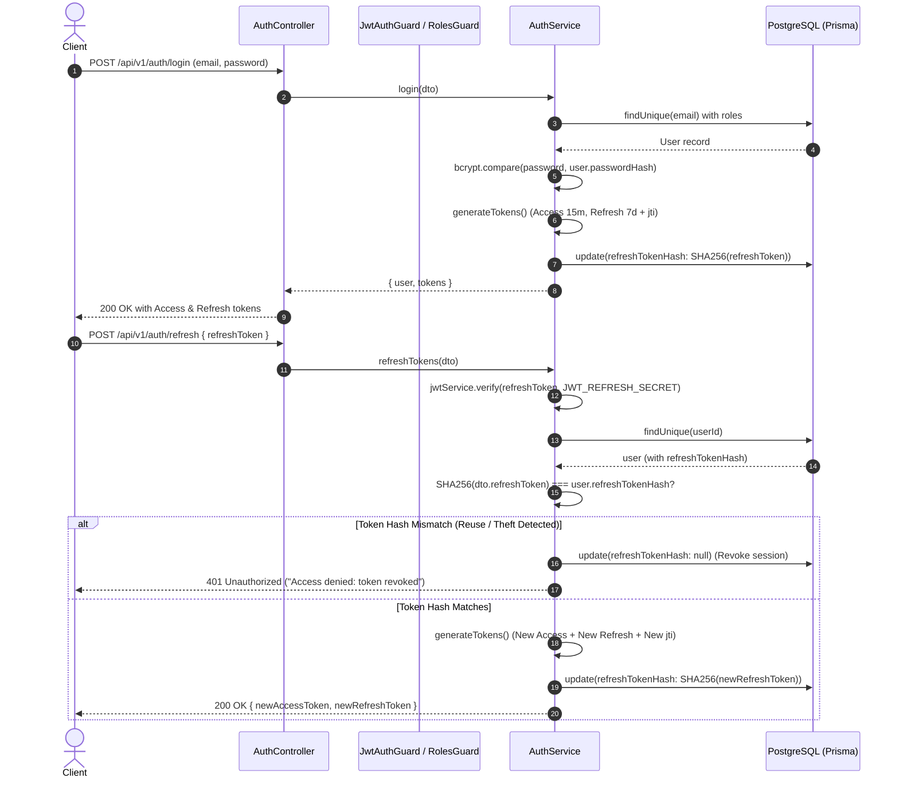
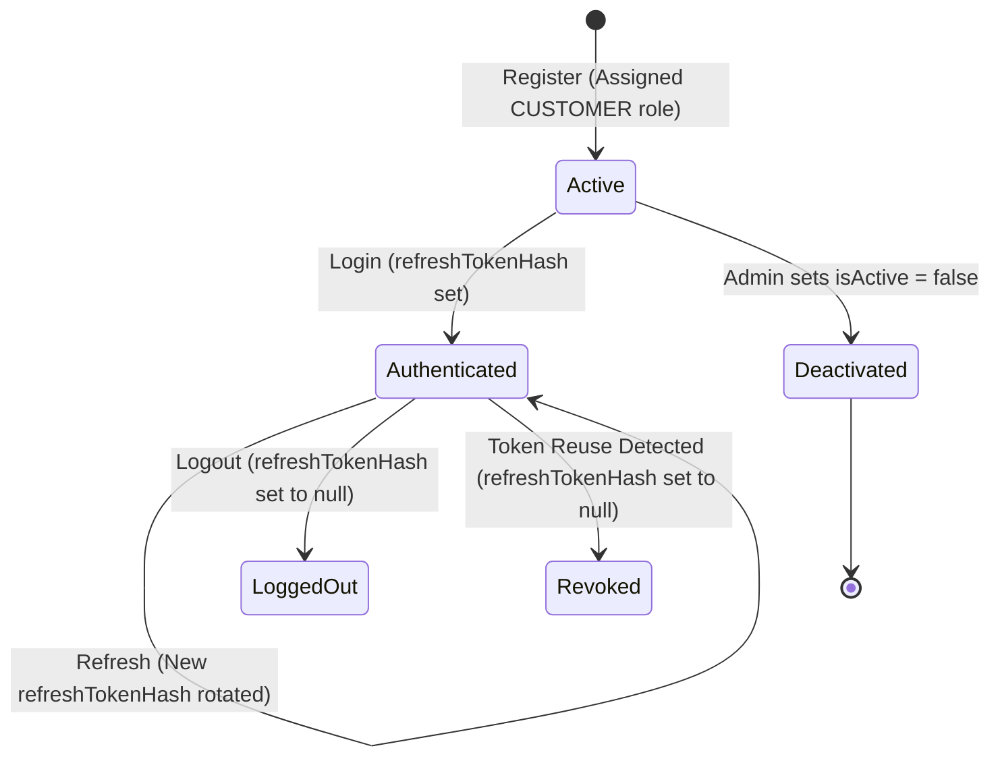

# Auth & Server RBAC Module Documentation

## 1. Overview

### Business Purpose
The Auth module provides identity verification, credential security, session management, and server-side Role-Based Access Control (RBAC) for the e-commerce and affiliate platform.

### Problems Solved
- **Secure Authentication:** Protects user passwords with salted one-way cryptographic hashing (`bcrypt`) and issues signed JSON Web Tokens (JWT).
- **Session Continuity with Security:** Provides a short-lived **Access Token (15m)** for low-latency API access and a long-lived **Refresh Token (7d)** with rotation to minimize exposure windows.
- **Token Theft & Replay Protection:** Detects refresh token reuse. If a revoked or previously used token is presented, the user session is immediately invalidated.
- **Server-Side Authorization (RBAC):** Prevents privilege escalation (`CUSTOMER`, `SELLER`, `AFFILIATE`, `ADMIN`) via server-authoritative guards rather than relying on client-side state.

### Responsibilities
- User account registration with default `CUSTOMER` role assignment.
- Credential validation and token pair generation.
- Cryptographic hashing of refresh tokens (using SHA-256 to prevent bcrypt truncation).
- Refresh Token Rotation (issuing a unique nonce `jti` per rotation).
- Revocation of refresh tokens on logout or token reuse.
- Extraction and validation of incoming JWT access tokens on every non-public route.
- Enforcement of role requirements on protected endpoints.
- **Fail-Fast Environment Security:** Strict bootstrap validation via `validateEnv` (`env.validation.ts`); enforces minimum 32-character cryptographic strength on `JWT_ACCESS_SECRET` and `JWT_REFRESH_SECRET`. Zero fallback strings allowed—the application immediately aborts startup if configuration is missing or weak.

### Scope and Limitations
- **Current Scope:** Implements email/password authentication, JWT bearer tokens, single-device refresh token rotation, and global RBAC role checking.
- **Limitations:** Multi-device simultaneous sessions are not currently tracked in a dedicated `user_sessions` table (a user currently maintains one active refresh token hash in `User.refreshTokenHash`). OAuth (Google/GitHub) and email verification flows are planned for future milestones.

---

## 2. Architecture and File Map

```text
server/
├── src/
│   ├── common/
│   │   ├── decorators/
│   │   │   ├── current-user.decorator.ts     # Extracts AuthenticatedUser from request
│   │   │   ├── public.decorator.ts           # Sets IS_PUBLIC_KEY metadata
│   │   │   └── roles.decorator.ts            # Sets ROLES_KEY metadata with UserRole[]
│   │   └── guards/
│   │       ├── jwt-auth.guard.ts             # Global AuthGuard('jwt') with @Public override
│   │       └── roles.guard.ts                # Validates user.roles against required roles
│   ├── modules/
│   │   └── auth/
│   │       ├── dto/
│   │       │   ├── register.dto.ts           # Email, password (min 6), fullName, phone
│   │       │   ├── login.dto.ts              # Email, password validation
│   │       │   └── refresh-token.dto.ts      # Refresh token payload validation
│   │       ├── strategies/
│   │       │   └── jwt.strategy.ts           # Passport JWT Strategy for Bearer validation
│   │       ├── auth.controller.ts            # HTTP endpoints under /api/v1/auth
│   │       ├── auth.service.ts               # Core authentication & cryptographic logic
│   │       └── auth.module.ts                # NestJS module bundling Passport, JWT & Prisma
│   ├── app.module.ts                         # Registers APP_GUARD -> JwtAuthGuard
│   └── main.ts                               # Sets global prefix /api/v1, ValidationPipe, CORS
└── test/
    └── auth.e2e-spec.ts                      # 10 integration tests covering full auth lifecycle
```

### Key Components and Responsibilities

| File Path | Symbol | Responsibility |
| :--- | :--- | :--- |
| `src/modules/auth/auth.service.ts` | `AuthService` | Hashes passwords (`bcrypt`), generates JWT pairs, hashes refresh tokens (`SHA-256`), rotates tokens, revokes tokens on logout or compromise. |
| `src/modules/auth/auth.controller.ts` | `AuthController` | Exposes `/api/v1/auth` endpoints (`register`, `login`, `refresh`, `logout`, `me`, `admin-test`). |
| `src/modules/auth/strategies/jwt.strategy.ts` | `JwtStrategy` | Extracts Bearer token, verifies signature and expiration, queries active user from database. |
| `src/common/guards/jwt-auth.guard.ts` | `JwtAuthGuard` | Global route guard; skips routes decorated with `@Public()`. |
| `src/common/guards/roles.guard.ts` | `RolesGuard` | Route guard; inspects `user.roles` against metadata set by `@Roles()`. |
| `src/common/decorators/current-user.decorator.ts` | `@CurrentUser()` | Parameter decorator yielding `AuthenticatedUser` (`userId`, `email`, `roles`). |

### Relevant Database Tables and Relationships

```prisma
model User {
  id               String               @id @default(uuid()) @db.Uuid
  email            String               @unique
  passwordHash     String
  fullName         String
  phone            String?
  isActive         Boolean              @default(true)
  refreshTokenHash String?              // SHA-256 hash of active refresh token
  roles            UserRoleAssignment[]
  createdAt        DateTime             @default(now())
  updatedAt        DateTime             @updatedAt
  @@map("users")
}

model UserRoleAssignment {
  userId    String   @db.Uuid
  role      UserRole // CUSTOMER, SELLER, AFFILIATE, ADMIN
  createdAt DateTime @default(now())
  user      User     @relation(fields: [userId], references: [id], onDelete: Cascade)
  @@id([userId, role])
  @@map("user_role_assignments")
}
```

### API Endpoints and Contracts

| Method | Endpoint | Auth Required | Request Body / Header | Response Format |
| :--- | :--- | :--- | :--- | :--- |
| `POST` | `/api/v1/auth/register` | No (`@Public`) | `RegisterDto` (email, password, fullName, phone) | `201 Created`: `{ user: { id, email, fullName, roles }, tokens: { accessToken, refreshToken } }` |
| `POST` | `/api/v1/auth/login` | No (`@Public`) | `LoginDto` (email, password) | `200 OK`: `{ user: { id, email, fullName, roles }, tokens: { accessToken, refreshToken } }` |
| `POST` | `/api/v1/auth/refresh` | No (`@Public`) | `RefreshTokenDto` (refreshToken) | `200 OK`: `{ accessToken, refreshToken }` |
| `POST` | `/api/v1/auth/logout` | Yes (`Bearer`) | None | `200 OK`: `{ message: "Logged out successfully" }` |
| `GET` | `/api/v1/auth/me` | Yes (`Bearer`) | None | `200 OK`: `{ userId, email, roles: UserRole[] }` |
| `GET` | `/api/v1/auth/admin-test`| Yes + `ADMIN` | None | `200 OK`: `{ message: "...", user: AuthenticatedUser }` (403 if not Admin) |

---

## 3. End-to-End Workflow

### Registration Workflow
1. Client sends `POST /api/v1/auth/register` with `RegisterDto`.
2. NestJS `ValidationPipe` enforces schema: valid email format, password $\ge$ 6 characters, non-empty full name.
3. `AuthService.register()` checks if `User.email` already exists (case-insensitive via `.toLowerCase()`). If found, throws `409 ConflictException`.
4. Password is salted and hashed using `bcrypt.hash(password, 10)`.
5. User is created in PostgreSQL with a nested `UserRoleAssignment` record (`role: UserRole.CUSTOMER`).
6. Token pair is generated. Refresh token includes `{ sub: user.id, email: user.email, jti: crypto.randomUUID() }`.
7. Refresh token is hashed via SHA-256 and stored in `User.refreshTokenHash`.
8. Returns user summary and tokens to client.

### Authentication & Token Rotation Workflow



---

## 4. Data Flow and State Transitions

### User Identity Lifecycle


### Enforced Rules
- `User.isActive`: If `false`, both login attempts and active JWT validations immediately fail with `401 Unauthorized`.
- `User.refreshTokenHash`: Nullable. When set to `null`, any subsequent refresh attempt fails immediately.
- `UserRoleAssignment`: Compound primary key `@@id([userId, role])` prevents duplicate role assignments.

---

## 5. Important Engineering Decisions

### 1. SHA-256 for Refresh Token Hashing (Resolving the Bcrypt 72-Byte Truncation Vulnerability)
- **Problem:** `bcrypt` has a hard limit of **72 bytes**. Standard signed JWTs are 150–250 bytes long. If a raw JWT is passed to `bcrypt.hash()`, bcrypt silently truncates the string at byte 72. Because JWT headers (`eyJhbGci...`) and initial payload keys (`{"sub":"...`) consume the first 60–70 bytes, two different refresh tokens for the same user could match the exact same bcrypt hash.
- **Solution:** In `AuthService.hashToken()`, the refresh token is passed through `crypto.createHash('sha256').update(token).digest('hex')`. This produces a 64-character deterministic digest spanning the entire token length, eliminating truncation and execution latency.

### 2. `jti` (JWT ID) Nonce for Guaranteed Uniqueness
- **Problem:** Standard JWT `iat` (Issued At) timestamps have a resolution of 1 second. If a user refreshes their token twice within the same second, the payload `{ sub, email }` and timestamp remain identical, generating identical token signatures and defeating rotation.
- **Solution:** Every refresh token payload includes `jti: crypto.randomUUID()`. Each generation is cryptographically unique regardless of execution speed.

### 3. Global Guard with Metadata Exemption
- **Decision:** `JwtAuthGuard` is registered globally using `APP_GUARD` in `AppModule`.
- **Rationale:** Secure by default. New endpoints are automatically protected unless an engineer explicitly marks them with `@Public()`. This prevents developers from accidentally exposing sensitive endpoints.

### 4. Normalized Multi-Role Structure (`UserRoleAssignment`)
- **Decision:** Roles are stored in a dedicated join table rather than a simple string column or string array on `User`.
- **Rationale:** Supports enterprise multi-persona requirements (a single user can be both a `CUSTOMER` and an `AFFILIATE` or `SELLER`). Database integrity is maintained via foreign key cascading.

---

## 6. Failure Scenarios

| Failure Scenario | Trigger / Root Cause | System Handling | Remaining Risk / Mitigation |
| :--- | :--- | :--- | :--- |
| **Token Theft / Replay Attack** | Attacker intercepts an old refresh token and tries to use it after the legitimate user has rotated it. | `incomingHash !== user.refreshTokenHash`. System detects reuse, sets `refreshTokenHash = null`, revokes the session, and throws `401 Access denied: token revoked`. | User must log in again. Client-side XSS prevention is required. |
| **Account Deactivation** | Admin sets `user.isActive = false` while user holds a valid 15-minute access token. | On the next protected request, `JwtStrategy.validate()` queries the database and rejects the request with `401 Unauthorized`. | Slight database query overhead on each request. Can be mitigated with a Redis revocation cache at higher traffic. |
| **Credential Guessing (Brute Force)** | Attacker submits repeated password attempts. | Returns uniform `401 Invalid email or password` without revealing whether the email exists. | Endpoint needs rate limiting (`@nestjs/throttler`) to throttle IP attempts (tracked for `OPS-01`). |
| **Expired Access Token** | 15-minute token expires during client usage. | Passport JWT returns `401 Unauthorized`. Client Axios interceptor captures 401 and calls `/auth/refresh`. | Handled automatically by client-side interceptor queues. |

---

## 7. Testing and Verification

### Test File
- [server/test/auth.e2e-spec.ts](file:///e:/CODE/Hoc/Bai/OnLaiNodejs/Project1/server/test/auth.e2e-spec.ts)

### Scenarios Verified
1. `POST /api/v1/auth/register` $\rightarrow$ Registers new user with hashed password, returns tokens and `CUSTOMER` role (201).
2. `POST /api/v1/auth/register` $\rightarrow$ Blocks duplicate email registration (409 Conflict).
3. `POST /api/v1/auth/register` $\rightarrow$ Blocks invalid email or password $< 6$ chars via `ValidationPipe` (400 Bad Request).
4. `POST /api/v1/auth/login` $\rightarrow$ Authenticates valid credentials and issues new token pair (200 OK).
5. `POST /api/v1/auth/login` $\rightarrow$ Rejects invalid password (401 Unauthorized).
6. `GET /api/v1/auth/me` $\rightarrow$ Blocks unauthenticated access without Bearer token (401 Unauthorized).
7. `GET /api/v1/auth/me` $\rightarrow$ Returns authenticated profile when valid Bearer token is provided (200 OK).
8. `GET /api/v1/auth/admin-test` $\rightarrow$ Blocks `CUSTOMER` from admin-only route via `RolesGuard` (403 Forbidden).
9. `POST /api/v1/auth/refresh` $\rightarrow$ Rotates refresh token, returns new pair, and rejects old refresh token reuse (200 OK then 401 Unauthorized).
10. `POST /api/v1/auth/logout` $\rightarrow$ Revokes token in database; subsequent refresh attempts fail (200 OK then 401 Unauthorized).

### Execution Command & Output
```bash
npm run test:e2e -- auth.e2e-spec.ts --runInBand
```
```text
PASS test/auth.e2e-spec.ts (20.177 s)
  Auth & RBAC (e2e)
    √ 1. POST /api/v1/auth/register -> should register new customer user (7337 ms)
    √ 2. POST /api/v1/auth/register -> should return 409 when registering duplicate email (508 ms)
    √ 3. POST /api/v1/auth/register -> should return 400 when validation fails (5 ms)
    √ 4. POST /api/v1/auth/login -> should login successfully with valid credentials (1632 ms)
    √ 5. POST /api/v1/auth/login -> should return 401 with wrong password (1078 ms)
    √ 6. GET /api/v1/auth/me -> should return 401 without Bearer token (4 ms)
    √ 7. GET /api/v1/auth/me -> should return profile with valid Bearer token (973 ms)
    √ 8. GET /api/v1/auth/admin-test -> should return 403 Forbidden for regular customer (950 ms)
    √ 9. POST /api/v1/auth/refresh -> should rotate refresh token and issue new pair (3344 ms)
    √ 10. POST /api/v1/auth/logout -> should revoke refresh token (2457 ms)

Test Suites: 1 passed, 1 total
Tests:       10 passed, 10 total
```

---

## 8. Technical Interview Preparation

### Part 1: Five Fundamental Questions

#### Q1: What is the lifecycle order of NestJS request processing, and where do Guards fit in?
- **What is evaluated:** Understanding of the NestJS execution pipeline.
- **Key Concepts:** Incoming Request $\rightarrow$ Middlewares $\rightarrow$ **Guards** $\rightarrow$ Interceptors (pre) $\rightarrow$ Pipes $\rightarrow$ Controller/Handler $\rightarrow$ Interceptors (post) $\rightarrow$ Exception Filters $\rightarrow$ Response.
- **Implementation Context:** `JwtAuthGuard` executes **before** pipes or controllers. If the token is invalid, execution halts immediately without allocating resources to validation pipes or service calls.
- **Follow-up:** *Can a Pipe intercept a request before a Guard?* No, Guards execute before Pipes because authorization must precede parameter parsing.

#### Q2: What is the difference between Authentication (AuthN) and Authorization (AuthZ)?
- **What is evaluated:** Core security definitions.
- **Key Concepts:** AuthN verifies *who you are* (Passport `JwtStrategy` checking token validity). AuthZ verifies *what you are allowed to do* (`RolesGuard` verifying `UserRole.ADMIN`).
- **Relevant Files:** `jwt.strategy.ts` (AuthN) vs `roles.guard.ts` (AuthZ).
- **Follow-up:** *Why is client-side route protection not considered authorization?* Client code can be manipulated or bypassed using raw HTTP calls (curl/Postman). Server-side authorization is the sole source of truth.

#### Q3: Why do we use both Access Tokens and Refresh Tokens instead of a single long-lived token?
- **What is evaluated:** Token lifecycle and attack window mitigation.
- **Key Concepts:** Access tokens are stateless and verified via signature without database lookups. A short lifespan (15 minutes) limits the window of opportunity if leaked. Refresh tokens are stateful (verified against `refreshTokenHash` in DB), allowing instant revocation on logout or compromise.
- **Follow-up:** *If an access token is leaked, can you revoke it immediately?* Stateless JWTs cannot be revoked before expiration unless a centralized blacklist (e.g., Redis) is queried on every request, which converts stateless JWTs back into stateful sessions.

#### Q4: How does NestJS Reflection (`Reflector`) work with Custom Decorators?
- **What is evaluated:** Metadata reflection in TypeScript/NestJS.
- **Key Concepts:** Custom decorators like `@Public()` and `@Roles()` attach metadata to method or class handlers using `SetMetadata()`. Guards retrieve this metadata at runtime via `reflector.getAllAndOverride<T>()`.
- **Relevant Files:** `src/common/decorators/public.decorator.ts` and `src/common/guards/jwt-auth.guard.ts`.
- **Follow-up:** *What does `getAllAndOverride` do compared to `get`?* It checks method-level metadata first; if present, it overrides class-level metadata.

#### Q5: How does password salting in `bcrypt` protect against rainbow table attacks?
- **What is evaluated:** Cryptographic storage standards.
- **Key Concepts:** A rainbow table is a precomputed table of hash values for common passwords. A random salt (10 rounds in our code) ensures that two users with the password `"Password123!"` produce completely distinct hashes, rendering precomputed tables ineffective.
- **Relevant Method:** `bcrypt.hash(dto.password, 10)` in `AuthService.register()`.

---

### Part 2: Five Implementation and Design Questions

#### Q6: Explain the bcrypt 72-byte truncation issue and how your implementation handles it.
- **What is evaluated:** Deep awareness of cryptographic library edge cases and token management.
- **Key Concepts:** `bcrypt` truncates input at 72 bytes. Passing raw JWTs (which exceed 150 bytes) causes token collisions.
- **Implementation Proof:** In `AuthService`, refresh tokens are hashed with SHA-256 (`crypto.createHash('sha256').update(token).digest('hex')`) before storing in `User.refreshTokenHash`.
- **Follow-up:** *Is SHA-256 secure enough for storing refresh tokens?* Yes. Refresh tokens possess high cryptographic entropy (256-bit signature + random UUID nonce), meaning dictionary attacks are infeasible. Bcrypt's artificial work factor is essential for low-entropy human passwords, but SHA-256 is optimal for high-entropy tokens.

#### Q7: How does Refresh Token Rotation work in your codebase, and what is Token Reuse Detection?
- **What is evaluated:** Resilience against token theft.
- **Key Concepts:** Each call to `/auth/refresh` issues a new token pair and overwrites `User.refreshTokenHash`. If an attacker and a legitimate user both attempt to use the same token, the second attempt will not match `refreshTokenHash`. The server detects reuse, immediately sets `refreshTokenHash = null`, and revokes access across the board.
- **Relevant Method:** `AuthService.refreshTokens()` in `src/modules/auth/auth.service.ts`.
- **Follow-up:** *What happens if network latency causes a legitimate client to retry `/auth/refresh`?* In high-concurrency mobile environments, a grace period of 5–10 seconds is sometimes allowed in Redis to prevent false-positive session revocation.

#### Q8: Why did you choose a Global Guard (`APP_GUARD`) over applying `@UseGuards(JwtAuthGuard)` on every controller?
- **What is evaluated:** Secure-by-default architectural design.
- **Key Concepts:** Human error prevention. In a growing codebase, a developer might forget to add `@UseGuards()`, inadvertently leaving an internal endpoint public. With `APP_GUARD`, everything is closed by default, requiring deliberate `@Public()` opt-outs.
- **Relevant File:** `src/app.module.ts`.

#### Q9: How does `JwtStrategy.validate()` handle deactivated users?
- **What is evaluated:** Balancing stateless tokens with real-time state enforcement.
- **Key Concepts:** Even though JWT signature verification is mathematical, `JwtStrategy.validate()` performs a fast database check: `if (!user || !user.isActive) throw new UnauthorizedException()`. This ensures that deactivated accounts are locked out immediately, without waiting for the 15-minute token to expire.
- **Relevant File:** `src/modules/auth/strategies/jwt.strategy.ts`.

#### Q10: Why are roles stored in a separate table (`UserRoleAssignment`) instead of an enum column on `User`?
- **What is evaluated:** Relational schema design for multi-persona applications.
- **Key Concepts:** In modern e-commerce, users often hold multiple roles (e.g., a buyer who is also an affiliate marketer or shop owner). A normalized relation prevents denormalized string parsing (e.g. comma-separated lists) and allows database-level constraints and auditing per role.
- **Relevant Model:** `UserRoleAssignment` in `prisma/schema.prisma`.

---

### Part 3: Three Failure, Concurrency, and Security Scenarios

#### Scenario 1: Two Refresh Requests Sent Simultaneously
- **Question:** *What happens if a frontend application fires two simultaneous API requests with an expired access token, causing two refresh calls to hit the backend concurrently?*
- **Current Behavior:** The first request completes, rotates the token, and updates `refreshTokenHash`. The second concurrent request arrives with the now-invalidated token, triggering the reuse detection branch and revoking the session.
- **Production Solution:** Frontend Axios interceptor queuing (only one refresh request is allowed inflight; all other 401s wait on the same Promise). Backend-side: a 5-second leeway buffer or distributed Redis lock.

#### Scenario 2: Database Outage During JWT Validation
- **Question:** *If PostgreSQL goes down, can the API still authenticate users?*
- **Current Behavior:** `JwtStrategy.validate()` attempts `prisma.user.findUnique()`. If PostgreSQL is unreachable, the request fails with a 500 error.
- **Production Improvement:** Cache active user profiles and their roles in Redis with a 5-minute TTL. Signature verification stays local, while active status checks read from in-memory cache.

#### Scenario 3: Storing Tokens in `localStorage` vs `HttpOnly` Cookies
- **Question:** *Where should the frontend store the access token and refresh token, and what are the security trade-offs?*
- **Key Concepts:**
  - `localStorage`: Vulnerable to Cross-Site Scripting (XSS). Any injected script can read `localStorage.getItem('token')`.
  - `HttpOnly` Cookies: Inaccessible to JavaScript, neutralizing XSS token theft. However, vulnerable to Cross-Site Request Forgery (CSRF). Mitigated with `SameSite: 'Strict'` or CSRF tokens.

---

## 9. Learning Gaps and Next Steps

### Concepts to Study Deeply
1. **Axios Response Interceptors:** How to implement a request queue to avoid concurrent refresh token collisions.
2. **Timing Attacks:** Using `crypto.timingSafeEqual` when comparing hashes to prevent side-channel timing analysis.
3. **Session Tables vs Single Hash:** How to transition from single-device refresh hashing to a `sessions` table storing `(userId, deviceId, userAgent, ipAddress, tokenHash, expiresAt)` for multi-device session management.

### Recommended Next Steps for Module
- [ ] Add `@nestjs/throttler` to `/auth/login` and `/auth/register` to mitigate automated credential stuffing.
- [ ] Implement Swagger/OpenAPI annotations on DTOs and Controller methods (`@ApiTags('Auth')`, `@ApiResponse()`).
