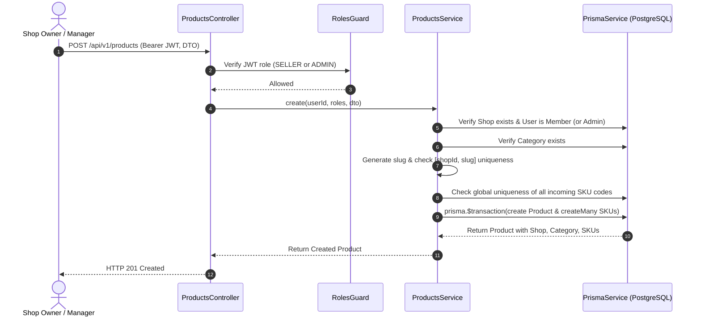
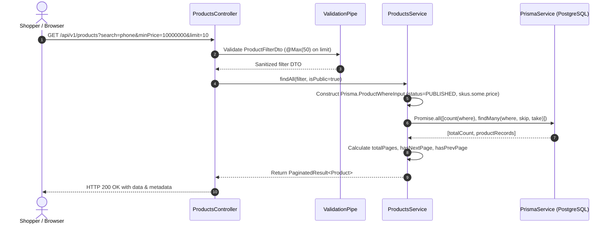

# Catalog Module Documentation (Categories, Products, SKUs, Bounded Pagination)

## 1. Overview

### Business Purpose
The Catalog module manages the hierarchical category structure, multi-variant products, and stock-keeping units (SKUs) across multi-vendor shops. It serves both public shoppers searching and filtering goods and authenticated merchants managing inventory, pricing, and affiliate commission rates.

### Problems Solved
- **Multi-Variant Product Modeling:** Separates the abstract product identity (name, brand description, shared media) from sellable physical variants (SKUs with unique codes, specific pricing, stock counts, and JSON attributes like color, size, and storage).
- **Multi-Tenant Shop Isolation:** Scopes product slug uniqueness to `@@unique([shopId, slug])`, enabling distinct sellers to list identically named products without naming collisions while keeping human-friendly SEO URLs.
- **Hierarchical Categorization:** Supports nested category trees (e.g., Electronics -> Smartphones -> Flagship Phones) using an adjacency list model with cascading constraints.
- **Safe & Bounded Pagination:** Enforces strict pagination boundaries (`limit <= 50`) to eliminate resource exhaustion and database Denial of Service (DoS) caused by unbounded queries.
- **Data Integrity & Relational Safety:** Enforces atomic creation of Products and initial SKUs via `prisma.$transaction`, and guards against deleting SKUs that have existing cart or order references via soft deactivation (`isActive: false`).

### Scope and Limitations
- **Current Scope:**
  - Public category listing and detail retrieval with product count aggregations.
  - Admin-only category creation, updating, and safe deletion.
  - Public search and filtering by keyword, category, shop, and SKU price range with bounded pagination metadata.
  - Merchant/Admin authorized product creation, updating, archiving, and SKU lifecycle management.
- **Limitations:**
  - Full-text search currently utilizes PostgreSQL ILIKE case-insensitive pattern matching via Prisma (`mode: 'insensitive'`). For ultra-large scale catalogs (millions of records), PostgreSQL `tsvector` with GIN indexing or external search engines (Elasticsearch / Meilisearch) will be considered in future phases.

---

## 2. Architecture and File Map

```text
server/
├── src/
│   ├── common/
│   │   ├── dto/
│   │   │   └── pagination.dto.ts             # PaginationQueryDto (max 50) & PaginatedResult<T>
│   │   └── utils/
│   │       └── slug.util.ts                  # Vietnamese diacritics stripping & URL-friendly slug generator
│   ├── modules/
│   │   ├── categories/
│   │   │   ├── dto/
│   │   │   │   ├── create-category.dto.ts    # DTO with name, optional slug, description, parentId
│   │   │   │   └── update-category.dto.ts    # PartialType update DTO
│   │   │   ├── categories.controller.ts      # Public GET, Admin-only POST/PATCH/DELETE
│   │   │   ├── categories.service.ts         # Hierarchy validation, slug conflict detection, safe deletion
│   │   │   └── categories.module.ts          # Exports CategoriesService
│   │   └── products/
│   │       ├── dto/
│   │       │   ├── create-sku.dto.ts         # SKU code, price, stock, JSON attributes, isActive
│   │       │   ├── update-sku.dto.ts         # PartialType SKU update DTO
│   │       │   ├── create-product.dto.ts     # shopId, categoryId, name, images, skus array
│   │       │   ├── update-product.dto.ts     # PartialType excluding shopId and skus
│   │       │   └── product-filter.dto.ts     # search, categoryId, shopId, minPrice, maxPrice, status, sortBy
│   │       ├── products.controller.ts        # Public search/detail & Seller/Admin management
│   │       ├── products.service.ts           # Atomic transaction creation, bounded query builder, access checks
│   │       └── products.module.ts            # Exports ProductsService
│   └── app.module.ts                         # Registers CategoriesModule and ProductsModule
└── test/
    └── catalog.e2e-spec.ts                   # 23 comprehensive integration tests
```

---

## 3. Data Model & Database Design

### Category Model (Adjacency List)
```prisma
model Category {
  id          String     @id @default(uuid()) @db.Uuid
  name        String
  slug        String     @unique
  description String?    @db.Text
  imageUrl    String?
  parentId    String?    @db.Uuid

  parent      Category?  @relation("CategoryTree", fields: [parentId], references: [id], onDelete: Restrict)
  children    Category[] @relation("CategoryTree")
  products    Product[]

  createdAt   DateTime   @default(now())
  updatedAt   DateTime   @updatedAt

  @@index([parentId])
  @@map("categories")
}
```

### Product & ProductSku Models (Variant Pattern)
```prisma
model Product {
  id             String        @id @default(uuid()) @db.Uuid
  shopId         String        @db.Uuid
  categoryId     String        @db.Uuid
  name           String
  slug           String
  description    String?       @db.Text
  images         String[]      @default([])
  status         ProductStatus @default(DRAFT)
  commissionRate Decimal?      @db.Decimal(5, 4)

  shop           Shop          @relation(fields: [shopId], references: [id], onDelete: Restrict)
  category       Category      @relation(fields: [categoryId], references: [id], onDelete: Restrict)
  skus           ProductSku[]

  createdAt      DateTime      @default(now())
  updatedAt      DateTime      @updatedAt

  @@unique([shopId, slug])
  @@index([shopId, status, createdAt])
  @@index([categoryId, status])
  @@map("products")
}

model ProductSku {
  id         String          @id @default(uuid()) @db.Uuid
  productId  String          @db.Uuid
  skuCode    String          @unique
  price      Decimal         @db.Decimal(12, 2)
  stock      Int             @default(0)
  attributes Json            @default("{}")
  isActive   Boolean         @default(true)

  product    Product         @relation(fields: [productId], references: [id], onDelete: Restrict)
  cartItems  CartItem[]
  orderItems ShopOrderItem[]

  createdAt  DateTime        @default(now())
  updatedAt  DateTime        @updatedAt

  @@index([productId, isActive])
  @@map("product_skus")
}
```

---

## 4. Execution Paths & Sequence Flows

### 4.1 Atomic Product & SKU Creation


### 4.2 Bounded Search & Filter Execution


---

## 5. Key Engineering Decisions & Trade-offs

| Decision | Alternative Considered | Engineering Rationale |
| --- | --- | --- |
| **Product + SKU Variant Pattern** | Flat Product Table (price, stock on Product) | Flat tables cannot represent size, color, or specification variations without creating duplicate product listings, confusing shoppers, and polluting search indexes. SKUs provide inventory-level granularity essential for carts and warehouses. |
| **`@@unique([shopId, slug])`** | Globally unique slug `@@unique([slug])` | In a multi-tenant marketplace, multiple shops frequently sell the same item (e.g. "iPhone 16 Pro"). Enforcing global slug uniqueness would force second merchants to append ugly random hashes. Scoping to shop preserves clean SEO URLs. |
| **Bounded Pagination (`limit <= 50`)** | Unbounded queries (`take: undefined`) | Prevents malicious or misconfigured clients from requesting `limit=100000`, which causes memory spikes, network congestion, and database query starvation. |
| **Atomic Transaction (`prisma.$transaction`)** | Sequential Product create then SKU create | If SKU creation fails (e.g. duplicate SKU code or DB disconnect), sequential creation leaves an "orphan" product without SKUs, causing broken cart workflows and frontend rendering errors. |
| **Soft SKU Deactivation vs Cascading Delete** | `onDelete: Cascade` on SKUs | Hard deleting an SKU that has historical orders or active carts violates financial auditability and breaks order history foreign keys (`ShopOrderItem.skuId`). Soft deactivation (`isActive: false`) preserves historical integrity. |
| **Adjacency List for Categories** | Closure Table / Materialized Path | E-commerce category trees rarely exceed 3-4 levels of depth. An adjacency list (`parentId`) is simple to maintain, incurs zero denormalization overhead on writes, and can easily be fetched with eager loading. |

---

## 6. Acceptance & Testing Evidence

All 23 integration test cases in `test/catalog.e2e-spec.ts` pass with zero regressions:
```text
PASS test/catalog.e2e-spec.ts (114.551 s)
  Catalog Module - Categories, Products, SKUs, Bounded Pagination (e2e)
    1. Category Management & RBAC
      √ 1.1 POST /api/v1/categories -> should reject unauthenticated request with 401
      √ 1.2 POST /api/v1/categories -> should reject CUSTOMER request with 403
      √ 1.3 POST /api/v1/categories -> should allow ADMIN to create root category
      √ 1.4 POST /api/v1/categories -> should allow ADMIN to create subcategory with parentId
      √ 1.5 POST /api/v1/categories -> should reject duplicate category slug with 409
      √ 1.6 GET /api/v1/categories -> public listing with subcategories and product counts
      √ 1.7 GET /api/v1/categories/:idOrSlug -> public fetch by slug
    2. Product & SKU Creation with Permissions
      √ 2.1 POST /api/v1/products -> 401 when unauthenticated
      √ 2.2 POST /api/v1/products -> 403 when seller does not belong to the shop
      √ 2.3 POST /api/v1/products -> 400 when duplicate SKU codes are sent in request
      √ 2.4 POST /api/v1/products -> 201 created atomically with initial SKUs by shop seller
      √ 2.5 POST /api/v1/products -> 409 when creating duplicate slug in same shop
      √ 2.6 POST /api/v1/products -> 409 when SKU code already exists globally
    3. Public Search, Filter & Bounded Pagination
      √ 3.1 GET /api/v1/products -> public paginated list with metadata
      √ 3.2 GET /api/v1/products?limit=100 -> strictly enforced bounded limit (Max 50 rejects with 400)
      √ 3.3 GET /api/v1/products?search=... -> keyword search in name and description
      √ 3.4 GET /api/v1/products?minPrice=30000000 -> filters out products without matching SKU price
      √ 3.5 GET /api/v1/products/:idOrSlug -> public detail with active SKUs
    4. SKU Management & Product Lifecycle
      √ 4.1 POST /api/v1/products/:id/skus -> seller can add a new SKU variant
      √ 4.2 PATCH /api/v1/products/skus/:skuId -> seller can update price & stock
      √ 4.3 DELETE /api/v1/products/skus/:skuId -> seller can deactivate/delete SKU
      √ 4.4 DELETE /api/v1/products/:id -> seller can archive product
      √ 4.5 GET /api/v1/products/:id -> archived product is not accessible publicly (404)

Test Suites: 1 passed, 1 total
Tests:       23 passed, 23 total
```

---

## 7. Technical Interview Preparation (Q&A)

### Q1: How do you model hierarchical data (categories & subcategories) in PostgreSQL, and why did you choose the Adjacency List pattern?
**Answer:**
There are four common patterns for modeling hierarchical trees in relational databases:
1. **Adjacency List (`parentId` column referencing `id` on the same table):** Simplest to implement, immediate single-row updates, foreign keys preserve referential integrity.
2. **Materialized Path (e.g. `/electronics/smartphones/apple`):** Fast subtree queries with `LIKE 'path%'`, but moving a category requires updating all descendant paths.
3. **Nested Sets (Left/Right bounds):** Extremely fast reads, but writes require re-indexing all node boundaries, making writes computationally heavy.
4. **Closure Table (separate table storing all ancestor-descendant relationships with path length):** Clean and flexible, but requires extra joins and storage.

For an e-commerce catalog, categories are rarely modified after setup, and depth is shallow (usually 2 to 3 tiers: Department -> Category -> Subcategory). The **Adjacency List** was chosen because it maintains ACID consistency with zero write overhead, allows direct recursive fetching using Prisma's `include: { children: true }`, and avoids redundant synchronization logic.

---

### Q2: Why did you separate the Product and ProductSku tables rather than keeping price and inventory on the Product table?
**Answer:**
In modern e-commerce (e.g. Amazon, Shopify, Shopee), products possess multiple physical variants (size, color, storage capacity, material). Each variant represents a distinct stockable unit:
- **Product Entity:** Holds brand identity, descriptive copy, shared media galleries, category classification, and overall reputation (reviews/ratings).
- **ProductSku Entity:** Holds the actionable financial and logistics attributes: a scannable Barcode/SKU code, exact unit selling price, physical warehouse stock count, and variant attribute map (`attributes: { "color": "Titanium", "storage": "256GB" }`).

If price and stock were stored on the Product table, merchants would either be forced to create separate product listings for every variant (fragmenting reviews and SEO rank), or use messy custom fields that break order line item tracking.

---

### Q3: How do you prevent N+1 query problems and unbounded query performance degradation in catalog browsing?
**Answer:**
1. **N+1 Prevention:** In `ProductsService.findAll`, rather than querying products and then issuing individual queries for each product's category, shop, and SKUs, we leverage Prisma's relational query engine to fetch all related entities in a single consolidated SQL batch using `include: { category: true, shop: true, skus: true }`.
2. **Parallel Aggregation:** Instead of executing `count()` sequentially after `findMany()`, we execute `Promise.all([this.prisma.product.count({ where }), this.prisma.product.findMany({ ... })])`, reducing network round-trip overhead.
3. **Bounded Limit:** Every query goes through `PaginationQueryDto` with class-validator `@Max(50)`. Any attempt to request an unbounded page size (e.g. `limit=10000`) is rejected at the HTTP gateway with `400 Bad Request`, preventing memory bloat and CPU starvation on PostgreSQL.

---

### Q4: Why is product slug uniqueness scoped to `@@unique([shopId, slug])` instead of a global `@@unique([slug])`?
**Answer:**
In a multi-vendor marketplace, multiple independent sellers legitimately sell identical branded goods (e.g., Shop A and Shop B both sell "Sony WH-1000XM5").
- If the slug were globally unique, only the first merchant could use `sony-wh-1000xm5`. Subsequent sellers would be forced into ugly URLs like `sony-wh-1000xm5-2` or `sony-wh-1000xm5-a8f3`.
- By scoping uniqueness to `@@unique([shopId, slug])`, both merchants retain clean, descriptive slugs within their shop namespace. At the URL level, routing is resolved either via `/shops/:shopSlug/products/:productSlug` or by primary UUID lookup.

---

### Q5: How do you handle SKU deletion when historical orders or active carts reference that SKU?
**Answer:**
In financial and commerce backends, **referential integrity and historical immutability are non-negotiable**. If a merchant deletes an SKU that has already been purchased, hard-deleting the row would break foreign keys in `order_items` or corrupt financial ledger reports.
- We check relational usage:
  ```ts
  if (sku._count.orderItems > 0 || sku._count.cartItems > 0) {
    await this.prisma.productSku.update({
      where: { id: skuId },
      data: { isActive: false },
    });
    return { message: 'SKU is linked to orders/carts and has been deactivated (soft-deleted)' };
  }
  ```
- If the SKU has historical references, we soft-deactivate it (`isActive: false`). Public queries filter by `where: { isActive: true }`, making it immediately invisible to buyers, while past orders and audit trails remain 100% intact.

---

### Q6: Why must Product and initial SKUs be created in a single database transaction (`prisma.$transaction`)?
**Answer:**
Product creation is an atomic multi-table operation. A sellable product without at least one valid SKU is in an invalid business state—it cannot be added to a cart, priced, or checked out.
If Product creation succeeded but SKU creation failed (for example, due to a duplicate SKU code constraint violation or network interruption):
- Without a transaction, the database would persist an "orphan" Product that appears in catalog queries but throws errors when a shopper attempts to buy it.
- Wrapping the operation in `prisma.$transaction` guarantees ACID atomicity: if any SKU fails validation or violates database constraints, the entire product creation rolls back completely, leaving the database clean.

---

### Q7: How does your search filter combine text search and SKU variant price ranges efficiently in SQL/Prisma?
**Answer:**
Shoppers frequently filter by text keywords (e.g. "iPhone") and price range (e.g. $500 - $1000). However, price lives on the child `ProductSku` table, while the name and description live on the parent `Product` table.
In `ProductsService.findAll`:
```ts
if (filter.minPrice !== undefined || filter.maxPrice !== undefined) {
  where.skus = {
    some: {
      isActive: true,
      price: {
        ...(filter.minPrice !== undefined ? { gte: new Prisma.Decimal(filter.minPrice) } : {}),
        ...(filter.maxPrice !== undefined ? { lte: new Prisma.Decimal(filter.maxPrice) } : {}),
      },
    },
  };
}
```
In PostgreSQL, Prisma translates `skus: { some: ... }` into an efficient `EXISTS (SELECT 1 FROM product_skus WHERE product_id = products.id AND is_active = true AND price >= $1 AND price <= $2)` subquery. Combined with the index `@@index([productId, isActive])`, this query resolves rapidly without table scans.

---

### Q8: How does server-side authorization verify shop ownership before allowing product mutations?
**Answer:**
We adhere to the rule that **client-provided IDs are never trusted blindly**.
When a seller issues a `POST /api/v1/products` or `PATCH /api/v1/products/:id`:
1. `RolesGuard` verifies that the authenticated user possesses the `SELLER` or `ADMIN` role.
2. In `ProductsService.assertShopAccess(shopId, userId, userRoles)`:
   - If the user has `ADMIN`, access is immediately granted (marketplace administration override).
   - For a `SELLER`, the service queries the `shop_members` table matching both `shopId` and the authenticated `userId`:
     ```ts
     const member = await this.prisma.shopMember.findUnique({
       where: { shopId_userId: { shopId, userId } },
     });
     if (!member) {
       throw new ForbiddenException('You do not have permission to manage products for this shop');
     }
     ```
This guarantees that Seller A cannot create, update, or archive products belonging to Seller B, even if Seller A tampers with the `shopId` in the request body.
